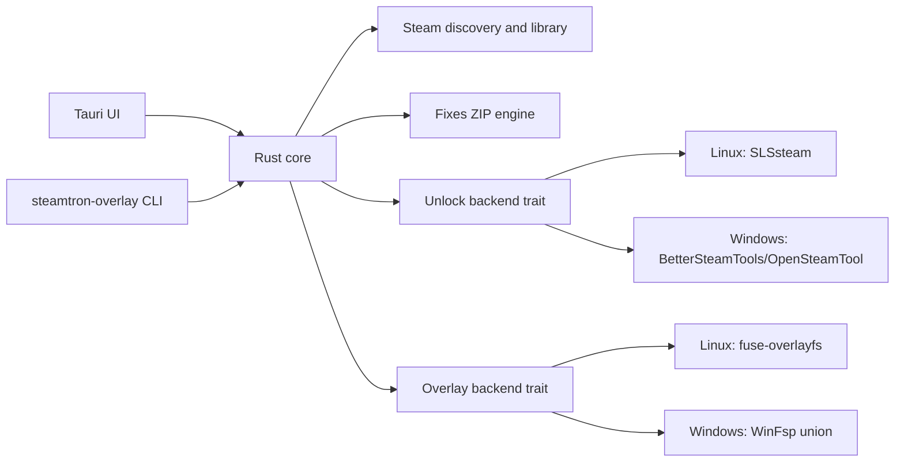

# SteamTron Desktop — Product Requirements and Engineering Decisions

Status: active  
Version: 0.1  
Last updated: 2026-11-03

This document is the source of truth for product scope, platform decisions, and
development conventions. If an implementation conflicts with this document,
either fix the implementation or amend the document with a dated decision.

## 1. Purpose

Build a standalone desktop application for Windows and Linux that replaces the
current in-Steam SteamTron plugin while preserving its functionality.

The desktop app must not require users to understand or manually install
SLSsteam, SteamTools, BetterSteamTools, LuaTools, Lumen, `stplug-in`, Proton, or
fix-overlay tooling.

## 2. Goals

- One user-facing application for Windows and Linux.
- Manage Steam library entries and Lua/manifest additions.
- Install, export, enable, disable, and remove per-game fixes.
- Apply fixes at game launch without modifying Steam common files.
- List/pin archived builds where the platform backend supports it.
- Manage required platform helpers automatically.
- Remove the Steam CEF plugin dependency after feature parity.

## 3. Non-goals

- Reimplementing the Steam client.
- Implementing our own Linux or Windows Steam hook in the first release.
- Supporting non-Steam stores in the first release.
- Replacing Steam's downloader, cloud saves, or anti-cheat.
- Guaranteeing compatibility with Steam client updates, anti-cheat, or protected
  games.
- Bundling or redistributing third-party binaries without verifying their
  licenses.

## 4. Terminology

| Term | Meaning |
|---|---|
| Desktop app | The Tauri application in this repository |
| Plugin | Existing in-Steam CEF UI and injector in the SteamTron repository |
| Unlock backend | Platform Steam-client hook that makes Lua/manifest entries work |
| Overlay backend | Platform virtual filesystem that presents fixes over game files |
| Fixes | Files layered over `steamapps/common/<Game>` at launch |
| Helper | A managed third-party component such as SLSsteam or BetterSteamTools |

`stplug-in` is a data directory. It is not an unlock backend by itself.

## 5. Decided stack

| Area | Decision |
|---|---|
| Desktop framework | Tauri 2 |
| Core language | Rust |
| UI | Tauri WebView; HTML/CSS/JS initially |
| Linux fixes overlay | `fuse-overlayfs` |
| Windows fixes overlay | Custom WinFsp union filesystem |
| Linux unlock backend | SLSsteam; Lumen is optional and not required |
| Windows unlock backend | BetterSteamTools primary; OpenSteamTool fallback |
| Lua/manifest format | Shared Lua + `.manifest` files |
| Shared app model | One Rust core; platform adapters behind traits |
| Legacy plugin | Keep until parity; then retire |
| rclone | Rejected as an overlay backend |
| ProjFS | Read-only fallback only; not exact writable overlay parity |

### Explicitly rejected

- Using LuaTools as a required dependency. It is a competing manager and its
  desktop application is Windows-only.
- Using SteamTools as the primary Windows backend when BetterSteamTools is
  available. BetterSteamTools is the active open-source fork of OpenSteamTool.
- Using `rclone mount` as a replacement for `fuse-overlayfs`. It does not
  implement overlay copy-up, whiteouts, or game-grade filesystem semantics.
- Shipping the plugin's CEF injector into the desktop app.

## 6. Architecture



### Workspace layout

```text
crates/
  steamtron-core/       Steam discovery, config, fixes ZIP, shared models
  steamtron-overlay/    Overlay layout and Linux fuse-overlayfs backend
  steamtron-unlock/     Platform unlock backend abstraction
  steamtron-cli/        CLI and launch wrapper
  steamtron-desktop/    Tauri app and UI
docs/                   PRD and engineering documentation
```

## 7. Platform backends

### Linux unlock

- Required: SLSsteam (`SLSsteam.so` + wrapper)
- Lumen: optional legacy CEF/UI sidecar; the desktop app does not require or install it
- Lua directory: `<Steam>/config/stplug-in`
- Manifest store: `$XDG_CONFIG_HOME/SLSsteam/manifests` (legacy `$XDG_DATA_HOME/SLSsteam/manifests` entries are also cleaned on removal)
- Depot manifests: `<Steam>/steamapps/depotcache`
- Detection: SLSsteam `.so` present; Lumen is optional
- Fixes-only operation must work without SLSsteam.

### Windows unlock

- Primary: BetterSteamTools
- Fallback: OpenSteamTool
- Steam discovery: `STEAM_PATH`, Program Files, registry-backed install path
- Lua directory: `<Steam>/config/stplug-in`, falling back to `<Steam>/config/lua`
- Backend files: `OpenSteamTool.dll`, `dwmapi.dll`, `opensteamtool.toml`
- Fixes-only operation must work without the unlock backend.

### Dependency policy

The user must not install helpers manually. The desktop app must:

1. Detect Steam and the platform backend.
2. Show a single “Steam library support” status.
3. Install or repair a pinned, checksum-verified helper after explicit consent.
4. Never expose raw `stplug-in`, `LD_AUDIT`, or DLL injection instructions in
   the normal UI.
5. Keep fixes available when library unlocking is unavailable.
6. Provide rollback and uninstall for managed helpers.
7. Record helper version and source in application state.

## 8. Fixes overlay requirements

The Linux behavior is the reference:

```text
lower layers: fixes : steam common
upper layer: persistent per-AppID directory
work layer: overlay metadata
merged path: read-only-looking game view with copy-up writes
```

- Never modify Steam common files.
- Preserve ZIP directory structure exactly.
- Keep upper-layer writes across launches.
- Clean up mounts on exit and crash recovery.
- Support launching the game executable and working directory from the merged
  view.
- Windows parity requires WinFsp copy-up, whiteouts, opaque directories,
  directory merge, rename/delete, locking, and memory-mapped file support.

## 9. Feature parity checklist

| Feature | Desktop status |
|---|---|
| Steam discovery and installed game list | Implemented |
| Per-game fixes config | Implemented |
| Fixes ZIP install/export | Implemented |
| Linux fuse-overlayfs engine | Implemented |
| Desktop library/fixes UI | Implemented |
| Settings with Profile and Doctor | Implemented |
| Unlock backend status | Implemented |
| Doctor checks and backend repair | Implemented in Settings > Doctor |
| Automatic backend installation/repair | Implemented via managed installer handoff; hardening pending |
| Search and add by game name, App ID, or Steam URL | Implemented with select-before-add results |
| Local Lua or Lua/manifest ZIP import for the selected game | Implemented; Lua App ID is validated |
| Account login/logout | Implemented; all app actions are gated behind sign-in |
| Update/build listing and pinning | Implemented from archived SLSsteam/depotcache manifests |
| Steam restart | Implemented from Settings |
| Steam launch-option setup | Implemented through `localconfig.vdf` and the dual-mode overlay wrapper |
| Managed library removal | Implemented with appmanifest/Lua/manifest/symlink cleanup |
| Linux deb/AppImage packaging | Implemented; deb and AppImage built |
| Windows WinFsp overlay | Pending |
| Plugin retirement | Pending |

## 10. Add game UX

The desktop app replaces the in-Steam button with a global flow:

```text
Library -> Add Game
  -> search by game name, App ID, or Steam URL
  -> show every matching Steam result
  -> select the exact game
  -> Add selected game / Import ZIP for selected game
  -> fetch public Lua/manifest bundle
  -> validate the Lua addappid matches the selection
  -> write backend data
  -> restart Steam if required
```

The online bundle comes from the public SteamML archive, not from a running
SteamTron plugin or local helper. Installed games are marked `In library` in
search results and cannot be added twice. Offline fallback: import a
Lua/manifest ZIP only after selecting the game; a ZIP whose Lua declares
another App ID is rejected. The desktop shell is locked behind account sign-in.
`Remove from library` deletes the Lua file, appmanifest, SLSsteam manifests,
preferred pins, and any managed common-directory symlink; real game directories
are left intact. `Restart Steam` is available from Settings. Managed games
also expose General, Fixes, and Updates tabs. Pinning writes the selected
depot GIDs and SLSsteam `ManifestPins`, while automatic mode clears both. Pin changes apply after uninstall/reinstall. No user-visible helper
installation is allowed.

## 11. Development rules

- Rust only for the new application. Do not add Python as a runtime dependency.
- Put portable behavior in `steamtron-core`; do not duplicate it in the UI.
- Put OS-specific work behind traits in `steamtron-overlay` and
  `steamtron-unlock`.
- UI commands must call core/backend APIs, never edit Steam files directly.
- Every file write to Steam or a helper directory must be atomic and validated.
- Preserve the existing SteamTron config and fixes paths for migration.
- New behavior requires a test at the lowest practical layer.
- Do not add a backend alternative without updating this PRD.

### Commands

```bash
cargo test --workspace
cargo run -p steamtron-desktop
cargo run -p steamtron-overlay-cli -- backend
cargo run -p steamtron-overlay-cli -- games
```

## 12. Plugin retirement criteria

The legacy plugin may be removed only after:

1. Desktop app supports all features in the parity checklist.
2. Desktop app installs and repairs its platform helpers.
3. Desktop app sets and clears Steam launch options.
4. Games launch through the overlay from Steam.
5. Account and update flows work.
6. The plugin service, injector, CEF requirement, and in-Steam UI can be removed
   without losing user state.
7. Rollback instructions are available.

The launch wrapper/overlay backend remains even after plugin removal.

## 13. Risks and constraints

- Steam client updates can break SLSsteam and BetterSteamTools.
- Windows WinFsp overlay is a substantial custom filesystem project.
- Anti-cheat and protected launchers may reject virtualized files.
- Third-party helper licenses must be reviewed before bundling.
- Automatic helper installation changes the user's Steam installation and needs
  clear consent and recovery.
- Steam launch options and manifest data are not official public APIs.

## 14. Decision log

| Date | Decision |
|---|---|
| 2026-11-03 | Use Tauri 2 and Rust for the desktop app |
| 2026-11-03 | Linux overlay: fuse-overlayfs |
| 2026-11-03 | Windows overlay: WinFsp union filesystem |
| 2026-11-03 | Linux unlock: SLSsteam (Lumen optional) |
| 2026-11-03 | Windows unlock: BetterSteamTools primary, OpenSteamTool fallback |
| 2026-11-03 | Do not use LuaTools, SteamTools-only, rclone, or ProjFS as the exact unified solution |
