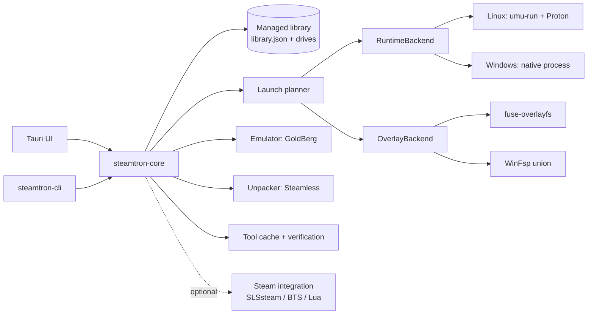

# SteamTron Desktop → Steam-agnostic migration PRD

Status: proposal for review
Version: 0.1
Date: 2026-11-09
Scope: this repository only (`SteamTron-Desktop`). **UmuTron is not refactored**: it is the behavioral reference implementation.

## 1. Why

SteamTron Desktop today is a Steam manager: it discovers the Steam library, writes
`localconfig.vdf` launch options, installs Lua/manifest entries through SLSsteam /
BetterSteamTools, and starts games through Steam. That makes Steam a hard
dependency for every game.

UmuTron proved the opposite contract on Linux: a managed library plus a fixes
overlay plus a Steam emulator (GoldBerg) and Steamless lets most Steam games run
**without a Steam client at all**. This PRD moves that contract into SteamTron
Desktop, cross-platform (Windows + Linux), while keeping the existing Steam mode
as an explicit, optional integration for the games that truly need it.

Non-negotiable framing:

- SteamTron Desktop is the product being changed.
- No Python code is shipped or executed; UmuTron modules are the specification.
- Steam is optional. Default Play must never require, start, or wait for Steam.
- Existing SteamTron data must be imported non-destructively.

## 2. Goals

1. One Tauri 2 application on Windows and Linux that runs Steam games without Steam.
2. Managed library (drives, games, prefixes, fixes) independent of the Steam client.
3. Launch pipeline with evidence, stop semantics, and diagnostics on both OSes.
4. Per-game Steam emulation automation (GoldBerg) and Steam DRM unpacking (Steamless).
5. Fixes overlay on both OSes (fuse-overlayfs / WinFsp) with one fixes location per game.
6. Optional per-game “Steam client required” mode: verify installed + running, never start it.
7. Import UmuTron libraries and existing SteamTron configuration without data loss.
8. Keep the current Steam features available as an opt-in integration, not the default path.

## 3. Non-goals

- Refactoring or shipping UmuTron.
- Reimplementing the Steam client or Steam Input.
- Bypassing Denuvo/EAC/BattlEye; documenting per-title workarounds as guarantees.
- Wine/Proton on Windows (native execution only).
- Mac support.
- Bundling third-party binaries without license review; tools are downloaded on demand.

## 4. Current state (audit)

| Area | SteamTron Desktop today | Steam-free target |
|---|---|---|
| Game identity | `appid` key in `config.json` | `Game.id` + optional `metadata_app_id` |
| Discovery | Steam `libraryfolders.vdf`, appmanifests (required) | Managed drives; Steam scan is an optional importer |
| Launch | `steam://rungameid`, `localconfig.vdf` options | Own supervisor + runtime adapter; Steam mode optional |
| Fixes | ZIP + fuse-overlayfs / WinFsp, keyed by appid | Same overlay backends, one canonical fixes folder per game |
| Unlock | SLSsteam / BetterSteamTools (required) | GoldBerg emulator (default); SLSsteam/BTS optional |
| Lua/manifest | `stplug-in`, depotcache | Optional “Steam integration” feature set |
| Runtime | Steam’s own Proton | Linux: umu-run + Proton; Windows: native |
| Updates/pins | Steam manifests | Keep; becomes optional Steam-mode feature |
| Doctor/auth/UI | Present | Keep; extend for new backends |

Existing crates stay, with new modules and two new platform crates:

```text
crates/
  steamtron-core/        models, storage, launch planner, fixes, tools, steam import
  steamtron-overlay/     fuse-overlayfs (Linux), WinFsp (Windows)  [keep]
  steamtron-runtime/     RuntimeBackend trait + supervisor contract
  steamtron-runtime-linux/   umu-run + Proton adapter
  steamtron-runtime-windows/ native process adapter
  steamtron-emulator/    GoldBerg assets + apply/remove
  steamtron-unpack/      Steamless assets + apply/remove
  steamtron-unlock/      SLSsteam / BetterSteamTools  [optional mode]
  steamtron-library/     backup, updates, importers
  steamtron-doctor/      diagnostics per backend
  steamtron-desktop/     Tauri commands + UI
  steamtron-cli/         headless: doctor, launch, fixes, tools
```

## 5. Architecture



Invariants (ported from UmuTron):

- Never write inside an installed game tree; the overlay is the only writable view.
- Never start, wait for, or depend on Steam unless a game explicitly requires it.
- One fixes location per game: `<drive>/<Library>/umuapps/fixes/<Game>`.
- Tools are downloaded once into app data, verified, and shared by every game.
- Every launch is owned by a supervisor process with a JSON run record and evidence.

## 6. Data model

New `library.json` (app data), replacing appid-keyed `config.json` for the
Steam-free path. Migration keeps the old file readable.

```json
{
  "version": 2,
  "settings": {
    "default_display_mode": "desktop",
    "gamemode": true,
    "picker_folders": { "fixes_export": "/mnt/x" }
  },
  "drives": [
    { "id": "drive-1", "root": "/mnt/krunal", "label": "Samsung", "default": true }
  ],
  "games": [
    {
      "id": "uuid",
      "title": "Cricket 26",
      "metadata_app_id": 3468650,
      "metadata_source": { "provider": "steam", "id": 3468650 },
      "installation": { "mode": "managed", "root": ".../umuapps/common/Cricket 26",
                        "prefix": ".../compatdata/Cricket 26", "proton": ".../runners/proton" },
      "launch": { "prefix_mode": "umu", "requires_steam": false,
                  "environment": {}, "arguments": [] },
      "launch_targets": [ { "id": "t1", "executable": "...", "primary": true } ],
      "fixes_enabled": true,
      "artwork": { "cover": "...", "hero": "..." }
    }
  ]
}
```

Layout per drive (compatible with UmuTron data):

```text
<drive>/UmuLibrary/umuapps/
  common/<Game>/                 installed game
  compatdata/<Game>/pfx          UmuTron prefix
  fixes/<Game>/                  single fixes location
  appmanifest_<App ID>.json      managed manifest (optional)
```

Decision to review: shared `UmuLibrary` name (import/export with UmuTron) versus
`SteamTronLibrary`. Recommendation: adopt `UmuLibrary` when it exists, otherwise
create it; never create a second library beside an existing one.

## 7. Launch contract

### 7.1 Linux

- `argv = [umu-run, <merged exe>, ...args]`; cwd is the merged game directory.
- Env whitelist (POSIX keys + locale, DISPLAY/Wayland, XDG, DBus, prime/GL).
- Prefix: `umu` mode (owned prefix) or `steam` mode (existing compatdata identity).
- `PROTONPATH` from the managed runner; `GAMEID=umu-<appid>` when available.
- `PROTON_LOG`/`PROTON_LOG_DIR` scoped to the run diagnostics folder.
- Optional Steam requirement check: installed + running, never started by us.
- Fixes DLLs → native-first `<name>=n,b` overrides, merged with user overrides.

### 7.2 Windows

- `CreateProcess` with the merged executable, working directory, and a sanitized
  environment; no Wine, no Proton, no Steam.
- Same fixes overlay contract through WinFsp; the same env-override rule is not
  needed (native loader order), but fixes DLLs still shadow game DLLs.
- Supervisor tracks the process, exit code, and evidence.

### 7.3 Fixes

- One canonical folder; import/export ZIP; enable/disable.
- Overlay mount verified writable before launch (probe write into upper layer).
- Sectioned UI: import/export · location · overlay · GoldBerg · Steamless.

## 8. Steam-free emulation

### 8.1 GoldBerg (always available)

1. Ensure the pinned `alex47exe/gse_fork` release in `<app data>/tools/goldberg/<tag>`.
2. Find the game’s original `steam_api(64).dll` (bounded, depth-first search).
3. Copy it into fixes, generate `steam_interfaces.txt` (Linux: `umu-run` + Wine;
   Windows: direct execution), then install the regular emulator DLL.
4. Write `steam_settings/` (`steam_appid.txt`, `steam_interfaces.txt`, `configs.*.ini`).
5. Record a payload manifest for exact removal; re-apply resets first, atomically.
6. Linux only: derive `PROTON_DISABLE_LSTEAMCLIENT`/`steam_api=n,b` visibility in
   the game Environment page; a running-Steam requirement always wins.

### 8.2 Steamless (always available)

1. Ensure the tool once in app data (Linux: `krunaldodiya/steamless-linux` +
   Wine; Windows: Steamless CLI + .NET runtime, source/licensing to confirm).
2. Copy every registered launcher into fixes preserving relative paths.
3. Skip launchers without a `.bind` section; run the tool on protected ones.
4. Record `{path, sha256}`; remove only unchanged files; report skipped/provided ones.

## 9. Optional Steam integration

Kept, but off the critical path:

- Per-game **Steam client** switch: verify installed and running; never start.
- Steam-prefix mode reuses `compatdata/<App ID>` and creates it when missing.
- SLSsteam / BetterSteamTools / Lua / depotcache remain for users who want them.
- Ownership caveat documented: an unowned App ID needs a client-side ownership
  patch (e.g. SLSsteam) or actual ownership; GoldBerg avoids the question.

## 10. UI parity checklist

| Screen | Source of behavior |
|---|---|
| Library grid, cards, pagination, search | SteamTron UI + UmuTron catalog |
| Detail: Play/Stop, launchers, size, app id | UmuTron detail page |
| Fixes: import/export, location, overlay | SteamTron fixes + UmuTron rules |
| Fixes: GoldBerg apply/remove | UmuTron `goldberg.py` behavior |
| Fixes: Steamless apply/remove | UmuTron `steamless.py` behavior |
| Compatibility: runtime, prefix source, requirement, paths | UmuTron compatibility page |
| Environment editor | UmuTron environment page |
| Storage/drives + backups/restore | SteamTron storage + UmuTron repair rules |
| Debug: run log, diagnostics, controller status | UmuTron debug + controller work |
| Doctor | SteamTron doctor, extended per backend |

File pickers remember the last folder per action; controller navigation uses
SDL polling with reconnect on focus; UI commands validate every path (no shell).

## 11. Migration and import rules

1. **SteamTron `config.json`** → `Game` entries with `metadata_app_id`; fixes
   folders move to the canonical library location when no conflict exists.
2. **Steam library scan** → optional “Linked” candidates; Play never requires
   Steam afterwards. Launch targets are restricted to the game folder.
3. **UmuTron `library.json` + `UmuLibrary`** → drives, games, prefixes, fixes,
   runners; unknown fields preserved; no files moved unless the destination is
   absent or empty. Identical duplicates collapse; differing trees are kept.
4. **Fixes ZIPs** import into the canonical folder; exports use the game name.
5. Every import is dry-run first and reports planned moves; nothing is deleted
   without an explicit confirmation.

## 12. Phases and acceptance

| Phase | Deliverable | Acceptance |
|---|---|---|
| 0. Baseline | This PRD, parity matrix, decisions on layout/tool sources | Reviewed and merged |
| 1. Core model | `library.json` v2, drives, validation, atomic writes, importers (dry-run) | Import of a real UmuTron library and old config without data loss; unit tests |
| 2. Linux runtime | Planner, supervisor, run record, evidence, Play/Stop, diagnostics | A Steam-free Linux game launches from the Tauri app; stop is owned; logs captured |
| 3. Windows runtime | Native supervisor + WinFsp overlay wiring | A Windows game launches with fixes applied; no Steam process required |
| 4. Steam-free tooling | GoldBerg + Steamless managers and UI sections | Apply/remove on both OSes; re-apply resets; unprotected launchers reported by name |
| 5. Steam mode (optional) | Requirement check, Steam prefix creation, SLSsteam/BTS as opt-in | Enabled game blocks Play with actionable error when Steam is not running; no auto-start |
| 6. UI parity | All checklist screens and commands | Manual matrix on desktop + TV; controller navigation and picker memory verified |
| 7. Library services | Backups/restore, integrity, updates (optional), doctor | Restore into a chosen drive; diagnostics explain failures |
| 8. Hardening | Cross-OS CI, fixtures, signing, docs, release | Both platforms build and pass the acceptance matrix |

## 13. Risks and mitigations

| Risk | Mitigation |
|---|---|
| WinFsp overlay maturity (copy-up, whiteouts, performance) | Reuse the existing WinFsp backend; add copy-up/whitespace conformance tests before UI integration |
| Wine dependency for Steamless on Linux | Keep it optional and reported in doctor; never block Play on it |
| Windows Steamless source/licensing | Decide before phase 4; otherwise gate the section to Linux temporarily |
| Sharing `UmuLibrary` with UmuTron | Document ownership rules; never merge differing trees; dry-run imports |
| Antivirus/signing on Windows | Sign binaries in phase 8; quarantine-first writes |
| Steam client/ownership ambiguity | Explicit per-game switch, clear errors, GoldBerg as the Steam-free default |
| Tool download availability | Pin URLs + checksums, cache, clear failure messages, retry/repair in doctor |

## 14. Testing strategy

- Rust unit tests for model, planner, env derivation, fixes rules, manifests.
- Fixture drives and fake runtime scripts (no real games) for supervisor tests.
- Overlay conformance per OS: mount, write probe, copy-up, unmount cleanup.
- Importers: golden UmuTron library and old SteamTron config; assert no mutation.
- End-to-end smoke per platform with one prepared game; document residuals.
- Tauri command tests for path validation and error surfaces.

## 15. Open questions

1. Library folder name: `UmuLibrary` (shared) vs `SteamTronLibrary` (isolated)?
2. Windows Steamless distribution: bundle, download, or Linux-only for v1?
3. Keep Lua/manifest and update pinning as optional features, or remove from the
   Steam-free product and offer them as an add-on?
4. Keep the account/catalog service and artwork repair?
5. Minimum platform matrix (Windows 10/11 builds, glibc/SteamRT versions).

## 16. Out of scope for v1 of this migration

- Anti-cheat or DRM beyond SteamStub.
- Multi-user Steam libraries and family sharing semantics.
- Cloud saves, achievements, overlay in-game UI.
- Automatic game downloads from Steam depots (existing downloader stays opt-in).
