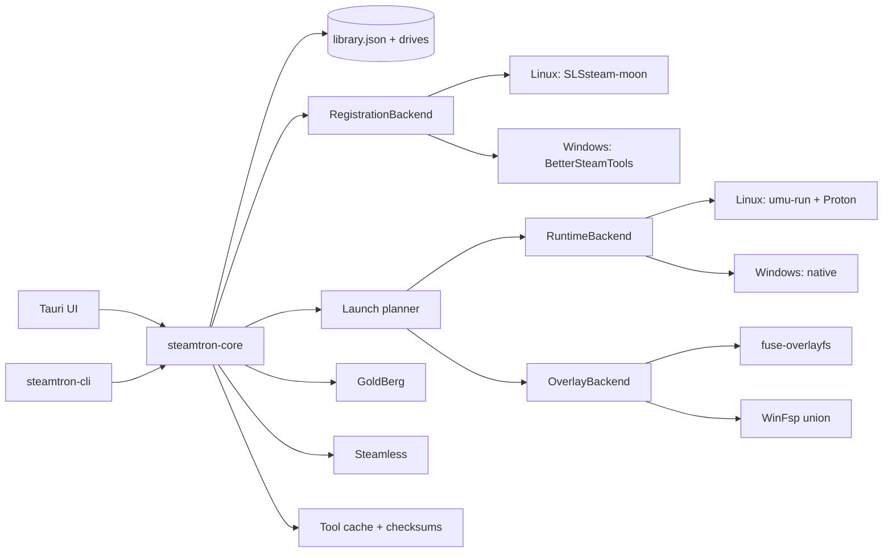
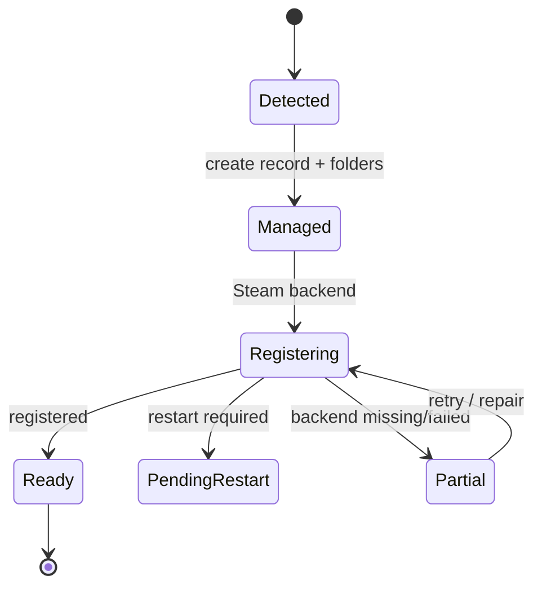

# SteamTron Desktop → dual-library, Steam-agnostic launcher

Status: proposal for review
Version: 0.3 (supersedes 0.1/0.2 in git history)
Date: 2026-11-09
Scope: this repository only (`SteamTron-Desktop`). **UmuTron is not refactored**: it is the behavioral and UI reference.

## 1. Why

Two products solved halves of the problem:

- **UmuTron** owns a managed game library, a fixes overlay, a launch supervisor,
  GoldBerg/Steamless automation, and a TV-friendly UI — but adding a game only
  touches its own library.
- **SteamTron Desktop** owns cross-platform packaging and Steam-library
  registration through SLSsteam-moon (Linux) and BetterSteamTools (Windows) — but
  adding a game only touches Steam, and its UI is built around Steam.

The product now **does both for every game**: one action adds the game to the
managed library *and* registers it in the Steam client's library. Content is
never downloaded by Steam; the Steam entry exists so the client reports the App
ID as owned when a title needs Steamworks. Launching remains ours, with the
Steam-free path as the default.

## 2. Goals

1. One Tauri 2 application on Windows and Linux whose UI/UX is adopted from
   UmuTron (see `UI-UX-MIGRATION.md`). UI is a first-class deliverable in every
   slice, not a final phase.
2. **Dual registration on add**: managed library entry + Steam library entry
   (SLSsteam-moon on Linux, BetterSteamTools on Windows), in one flow.
3. Managed content layout and launch supervisor independent of Steam.
4. Three explicit launch modes per game:
   - **Emulator (default where it works)**: GoldBerg, no Steam client required.
   - **Steam client**: the registered App ID is used through the running client
     (required by some Steamworks titles). Never started automatically.
   - **Native**: no Steamworks at all (Linux: UMU/Proton may still be the runtime).
5. Fixes overlay on both OSes with one canonical fixes folder per game.
6. GoldBerg and Steamless automation as first-class fixes sections.
7. Import UmuTron libraries and existing SteamTron configuration without data loss,
   registering imported games in Steam when they are not already present.
8. Keep Steam registration repairable: verify, re-register, remove, and explain
   partial states in the UI.
9. **Keep Doctor as a must-have, first-class feature, scoped to registration
   backends.** The existing `steamtron-doctor` crate validates SLSsteam-moon and
   BetterSteamTools only: installation, readiness, client compatibility, and
   registration behavior. It does not validate games.

## 3. Non-goals

- Refactoring or shipping UmuTron.
- Downloading game content through Steam; repositories/manifests stay optional.
- Reimplementing Steam Input, cloud saves, achievements, or anti-cheat.
- Bypassing Denuvo/EAC/BattlEye.
- Wine/Proton on Windows.
- Mac support.
- Auto-starting the Steam client. The app may ask the user to start it.
- **Activity history.** No global Activity screen and no per-game Activity tab.
  Run evidence, logs, and failure explanations live in Debug and Doctor; the
  existing SteamTron localStorage activity log and UmuTron's Activity button are
  not carried over.

## 4. Current state (audit)

| Area | SteamTron today | Target |
|---|---|---|
| Game identity | `appid` key in `config.json` | `Game.id` + optional `metadata_app_id` |
| Add game | Steam Lua/manifest entry only | Managed entry **and** Steam registration |
| Content | Steam `steamapps/common` | Managed drives (`UmuLibrary/umuapps`) |
| Registration | SLSsteam / BetterSteamTools (only path) | Registration backends behind a trait, mandatory on add |
| Launch | `steam://rungameid` / launch options | Own supervisor + runtime adapters; Steam client mode optional per game |
| Fixes | ZIP + fuse/WinFsp keyed by appid | Same backends, canonical folder, GoldBerg + Steamless sections |
| Runtime | Steam's Proton | Linux: umu-run + Proton; Windows: native |
| UI | Steam catalogue-centric Tauri UI | UmuTron library/detail/fixes/compatibility UI |

## 5. Product model

### 5.1 Dual registration

```text
        +----------------------+        +---------------------------+
 add -> | Managed library      |        | Steam client library      |
        | drives, prefixes,    |  +-->  | SLSsteam-moon (Linux)     |
        | fixes, launch config |        | BetterSteamTools (Windows)|
        +----------------------+        +---------------------------+
                 |                                   |
                 | content stays here                | ownership + library entry only
                 +-----------------+-----------------+
                                   |
                               Play (ours)
```

- Every added game gets a managed record and a Steam registration.
- Registration grants the App ID to the client; it never downloads content.
- Removing a game from our library offers to remove the Steam registration too.
- Registration is idempotent and verifiable; re-adding repairs a missing entry.

### 5.2 Registration states

| State | Meaning | UI |
|---|---|---|
| `registered` | Backend reports the App ID present | Ready |
| `pending_restart` | Written, but the client must restart | “Restart Steam to finish” |
| `backend_missing` | SLSsteam/BTS not installed or not ready | Actionable error + doctor link |
| `client_stopped` | Backend needs the client to apply live | Ask user to start Steam |
| `failed` | Backend rejected the entry | Retry / details |

### 5.3 Launch modes

| Mode | Requires Steam client | When |
|---|---|---|
| `emulator` | No | Default. GoldBerg replaces the Steam library and interfaces |
| `steam_client` | Yes, running | Titles that need real Steamworks/ownership behavior |
| `native` | No | Games without Steamworks, or native Linux builds |

Selection rules:

- Default from detection: a game with a `steam_api(64).dll` → `emulator`;
  otherwise `native`.
- `steam_client` is opt-in per game and verified at Play (installed + running,
  registration present). Never started by us.
- A failed emulator launch can be retried in `steam_client` mode without
  re-adding the game.

## 6. Architecture



Invariants:

- Never write inside an installed game tree; the overlay is the writable view.
- Never start Steam; only verify and ask.
- One fixes location per game: `<drive>/<Library>/umuapps/fixes/<Game>`.
- Registration and content are independent: a failed registration never blocks
  editing, importing fixes, or removing content.
- Tools are downloaded once, verified, and shared.

## 7. Crates

```text
crates/
  steamtron-core/            models, storage, planner, fixes, tools, steam import
  steamtron-overlay/         fuse-overlayfs (Linux), WinFsp (Windows)        [keep]
  steamtron-runtime/         RuntimeBackend + supervisor contract            [new]
  steamtron-runtime-linux/   umu-run + Proton                               [new]
  steamtron-runtime-windows/ native process                                 [new]
  steamtron-register/        RegistrationBackend + Linux/Windows adapters    [renamed from unlock]
  steamtron-emulator/        GoldBerg assets and apply/remove                [new]
  steamtron-unpack/          Steamless assets and apply/remove               [new]
  steamtron-library/         importers, backup, optional updates/manifests   [extend]
  steamtron-doctor/          checks per backend and per game                 [extend]
  steamtron-desktop/         Tauri commands + UmuTron-derived UI             [extend]
  steamtron-cli/             headless doctor/register/launch/fixes           [extend]
```

## 8. Data model

```json
{
  "version": 2,
  "settings": { "default_display_mode": "desktop", "gamemode": true,
                "picker_folders": { "fixes_export": "/mnt/x" } },
  "drives": [ { "id": "d1", "root": "/mnt/krunal", "label": "Samsung", "default": true } ],
  "games": [ {
      "id": "uuid",
      "title": "Cricket 26",
      "metadata_app_id": 3468650,
      "installation": { "mode": "managed", "root": ".../umuapps/common/Cricket 26",
                        "prefix": ".../compatdata/Cricket 26", "proton": ".../runners/valve-experimental" },
      "steam": { "app_id": 3468650, "registered": true, "backend": "slssteam-moon",
                 "state": "registered", "registered_at": 0, "launch_mode": "steam_client" },
      "launch": { "prefix_mode": "steam", "requires_steam": true, "environment": {} },
      "launch_targets": [ { "id": "t1", "executable": "...", "primary": true } ],
      "fixes_enabled": true,
      "artwork": { "cover": "...", "hero": "..." }
  } ]
}
```

Per drive:

```text
<drive>/UmuLibrary/umuapps/
  common/<Game>/      installed content (ours)
  compatdata/<Game>/  UmuTron prefix
  fixes/<Game>/       single fixes location
  appmanifest_<App ID>.json   managed manifest (optional)
```

## 9. Add-game transaction



Rules:

- Managed creation is committed first; registration is a retryable step.
- The UI shows both columns in the add flow: “Library” and “Steam”.
- A partial add still appears in the library with a repair action.
- Duplicate App IDs merge into one record; registration is refreshed, not duplicated.
- The registration backend receives only the App ID and display title.
- No content is copied into Steam libraries.

## 10. Launch contract

### 10.1 Linux

- `[umu-run, <merged exe>, args...]`, cwd = merged directory.
- Prefix `umu` (owned) or `steam` (compatdata identity).
- `steam_client` mode: verify registration + client running; `lsteamclient`
  must stay enabled.
- `emulator` mode: GoldBerg DLL from fixes; `steam_api(64)=n,b` and, where
  relevant, `PROTON_DISABLE_LSTEAMCLIENT` visible in Environment.
- Fixes DLLs → native-first `<name>=n,b`, merged with user overrides.

### 10.2 Windows

- Native `CreateProcess` with merged cwd and sanitized environment.
- WinFsp overlay provides the fixes view.
- `steam_client` mode verifies registration and the running client.
- `emulator` mode uses the GoldBerg Windows DLL; no Wine.

### 10.3 Supervisor

- Separate process/thread, JSON run record, stop semantics, selected-path evidence,
  diagnostics folder, recent-play timestamp only after continuous evidence.

## 11. Fixes

- One canonical folder; import/export ZIP (game-name file); enable/disable.
- Overlay verified writable before launch.
- Sections: import/export · location · overlay · GoldBerg · Steamless.
- **GoldBerg**: pinned tool, original DLL discovery, interface generation,
  `steam_settings`, payload manifest, reset-on-reapply, exact removal.
- **Steamless**: per-launcher copies, `.bind` pre-check, recorded removal,
  skip/report unprotected and fix-provided launchers.

## 12. Registration backends

Contract:

```rust
trait RegistrationBackend {
    fn status(&self) -> BackendStatus;
    fn register(&self, app_id: &str, title: &str) -> Result<Registration>;
    fn verify(&self, app_id: &str) -> Result<Registration>;
    fn unregister(&self, app_id: &str) -> Result<()>;
    fn requires_restart(&self) -> bool;
}
```

- **Linux**: SLSsteam-moon; writes the client's app/library state, verified by
  the backend's own metadata (`stplug-in`, library cache, added-times). The
  client may need a restart before ownership is visible.
- **Windows**: BetterSteamTools (OpenSteamTool fallback); the same contract.
- The app never launches Steam; it asks the user and re-verifies on focus.
- Registration removal is confirmed and only touches our App IDs.
- Doctor checks: backend installed/ready, client version support, registration
  present, ownership visible, and restart pending.

## 13. Doctor — registration backend validation (must-have)

Doctor validates **only** the Steam registration backends: SLSsteam-moon on Linux,
BetterSteamTools / OpenSteamTool on Windows. It never inspects or repairs games,
drives, runtimes, fixes, or tools; those surfaces own their own state and errors.

### 13.1 Contract

```rust
struct DoctorCheck {
    id: &'static str,
    title: &'static str,
    status: CheckStatus,        // ok | warning | error | unavailable
    detail: String,
    repair: Option<RepairKind>, // backend-scoped, idempotent, user-confirmed
}
```

- Checks never mutate; repairs are separate and explicit.
- Repairs never start Steam and never touch game content.
- One section per backend; the backend that does not apply to the platform is
  reported as `unavailable`, not as an error.
- Surfaces: UI dashboard and `steamtron-cli doctor [--json]`.
- The crate is retained (`steamtron-doctor`) and extended for the new
  `RegistrationBackend` trait; it is not replaced by per-screen errors.

### 13.2 Checks

| Check | Detail | Repair |
|---|---|---|
| Backend present | SLSsteam `.so` + wrapper, or BetterSteamTools install | Explain and link setup; install is explicit |
| Backend ready | injection/loader configured for the current client | Re-apply backend setup |
| Client found | Steam install path resolved | Show the expected path |
| Client version supported | known-good build range for the backend | Warn, link upstream, offer re-check |
| Registration visible | App ID present in the client's library/ownership state | Register through the backend; verify |
| Pending restart | backend wrote state; the client must restart | Ask the user; re-verify on focus |
| Orphan entries | App IDs no longer managed by us | Offer removal (our IDs only) |
| Conflicting backends | more than one registration backend active | Explain and disable one |
| Backend error log | last backend failure message | Show detail; retry |

### 13.3 Outside Doctor

| Failure | Where it is shown |
|---|---|
| Missing/renamed game files, stale launch target | Game detail, Play error |
| Prefix missing or runner unavailable | Compatibility page, Play error |
| Overlay backend unavailable | Fixes → launch overlay section |
| GoldBerg/Steamless tool or payload problems | Fixes sections |
| Per-game registration state while adding | Add flow and Compatibility |
| Run logs and evidence | Debug |

## 14. UI (from UmuTron)

The full screen map, component rules, tokens, controller model, Tauri command
contract, and UI-first slices live in [`UI-UX-MIGRATION.md`](UI-UX-MIGRATION.md).
That document is the source of truth for anything the user sees.

- Library/Home/detail with Play/Stop, launcher picker, size, App ID.
- Add flow shows both targets and per-target state.
- Compatibility: runtime, prefix source, launch mode, Steam client requirement,
  resolved Proton/prefix paths.
- Environment editor, Debug (logs, run evidence, controller status), Storage/drives,
  Backups, Integrity, and **Doctor** as a top-level screen for registration
  backend validation (SLSsteam-moon / BetterSteamTools). No per-game Doctor.
- Controller navigation (SDL polling, reconnect on focus), picker memory,
  TV/fullscreen parity.
- No Activity tab in the detail page and no global Activity screen. Debug
  carries run logs and evidence; Doctor carries registration-backend problems
  and repairs; each job exists exactly once.

## 15. Migration and import

1. **SteamTron `config.json`** → managed games; register missing entries.
2. **UmuTron library + drives** → drives, games, prefixes, fixes; register
   missing Steam entries for games with an App ID; never move differing trees.
3. **Steam library scan** → linked candidates; content stays where it is.
4. **Fixes ZIPs** import into the canonical folder.
5. Every import is dry-run first and reports planned moves and registrations.
6. No automatic deletion; removal requires confirmation and reports what is kept.
7. Existing SteamTron activity history is not imported and no new history store
   is written; Debug logs and Doctor checks replace it.

## 16. Phases and acceptance

| Phase | Deliverable | Acceptance |
|---|---|---|
| 0. Decisions | PRD, library folder name, backend matrix, launch-mode defaults, Doctor backend check map | Reviewed and merged |
| 1. Core model | `library.json` v2, drives, validation, dry-run importers, **UI U0 (design system + shell)** | Import with zero data loss; shell matches the UI tokens |
| 2. Dual add | Add-game transaction, registration backends, **UI U3 add stepper**, **all backend Doctor checks/repairs** | Adding registers or reports exact state; Doctor validates the backend and clears pending restarts |
| 3. Linux runtime | Planner, supervisor, evidence, Play/Stop | Steam-free launch; runtime problems surface on Compatibility/Play |
| 4. Windows runtime | Native supervisor + WinFsp overlay | Windows launch with fixes |
| 5. Emulation tooling | GoldBerg + Steamless managers and UI | Apply/Remove/re-apply; tool problems surface in the sections |
| 6. Steam client mode | Requirement check, registration verification, ownership errors, contradiction checks | Blocked Play explains the state; backend failures link to Doctor |
| 7. UI polish | TV/fullscreen, controller walkthrough, golden screenshots, parity of every screen | Controller-only walkthrough on 1080p/720p/600p; snapshot diffs reviewed |
| 8. Library services | Backups/restore, integrity, optional updates | Restore to chosen drive; failures explained |
| 9. Hardening | Cross-OS CI, signing, docs, release | Both platforms pass the acceptance matrix |

## 17. Risks

| Risk | Mitigation |
|---|---|
| Registration backend unavailable/unsupported client build | Doctor check, clear error, retry, backend fallback |
| Client restart needed after registration | Explicit `pending_restart` state and re-verify on focus |
| WinFsp overlay fidelity | Conformance tests before UI wiring |
| Windows Steamless source/licensing | Decide in phase 0; Linux-only gating if unresolved |
| Sharing `UmuLibrary` with UmuTron | No-merge rule, dry-run imports, never delete |
| Steamworks titles that still need the real client | Launch mode switch without re-adding; documented ownership caveat |
| Antivirus/signing on Windows | Signed binaries, quarantine-first writes |

## 18. Testing

- Rust unit tests for model, add transaction, registration contract, planner,
  fixes rules, manifests.
- Fake registration backends for every state (`registered`, `pending_restart`,
  `backend_missing`, `failed`).
- Doctor backend checks and repairs for every backend state, including
  idempotent re-runs, `unavailable` on the other platform, and refusal to start
  Steam or delete user files.
- Fixture drives and fake runtimes for supervisor tests.
- Overlay conformance per OS.
- Importers: golden UmuTron library and old SteamTron config; assert no mutation.
- End-to-end smoke per platform with one prepared game.

## 19. Open questions

1. Library folder name: shared `UmuLibrary` or `SteamTronLibrary`?
2. Windows Steamless: bundle, download, or Linux-only for v1?
3. Should removing a game always unregister from Steam, or ask (recommend ask)?
4. Keep Lua/manifest and update pinning as optional features?
5. Keep the account/catalog service?
6. Minimum Windows/Linux matrix (Windows 10/11, glibc/SteamRT versions)?

## 20. Delivery strategy

**Recommendation: phase-wise vertical slices, not a big-bang rewrite.**

### 20.1 Why not all at once

- The two highest-risk pieces are external and version-sensitive: WinFsp overlay
  fidelity on Windows and SLSsteam-moon/BetterSteamTools behavior across client
  builds. They must be proven early, not at the end.
- The data model (`library.json` v2) and the traits are consumed by every layer.
  Writing UI and services against an unstable model guarantees rework.
- Existing working features (fixes ZIP, overlay backends, doctor, backups,
  Tauri shell) must keep working during the migration; a big-bang branch hides
  regressions until the end.
- Reviews, bisecting, and release notes are tractable per slice; a single
  10k-line change is not.
- Cross-platform work benefits from a Linux-first walking skeleton: every later
  slice is a variation of a proven path.

### 20.2 Rules

1. Every phase ends with a **runnable app** and its acceptance test; no
   half-merged layers.
2. **Contracts freeze first**: `library.json` v2 schema, `RuntimeBackend`,
   `OverlayBackend`, `RegistrationBackend`, `DoctorCheck`. Changes after the
   freeze require a documented amendment.
3. Each slice is vertical: model → planner → runtime → UI affordance → test.
4. The current Steam mode stays available behind a setting until parity; no
   long-lived branches, no feature removal before its replacement passes.
5. Doctor is extended in the same slice that adds a registration backend
   capability, never later.
6. Importers are dry-run and land before any file movement.

### 20.3 Walking skeleton order

| Step | Slice | Platform |
|---|---|---|
| 1 | Add game (managed + registered) → Play via GoldBerg → Stop → Doctor | Linux |
| 2 | Same slice | Windows |
| 3 | Steamless section | both |
| 4 | Steam client mode + registration verification | both |
| 5 | Importers, backups, full UI parity, hardening | both |

### 20.4 Parallel tracks after the freeze

With the model and traits fixed, up to three tracks can proceed without blocking:

- **Track A** — Linux runtime, supervisor, evidence, Steam prefix creation.
- **Track B** — Windows runtime, WinFsp conformance, native supervisor.
- **Track C** — registration backends, Doctor, emulator/unpacker tool managers.
- **Track D (continuous)** — UI slices U0–U7 from `UI-UX-MIGRATION.md`; every
  backend slice ships with its screen, and no screen ships without its golden
  screenshots.

Tracks meet at the add flow, Play, and Doctor; those are the integration gates.

### 20.5 Rough size

| Phase | Size | Depends on |
|---|---|---|
| 0 Decisions | S | — |
| 1 Core model + importers | M | 0 |
| 2 Dual add + registration + Doctor | L | 1 |
| 3 Linux runtime | M | 1 |
| 4 Windows runtime + WinFsp | L | 1, overlay conformance |
| 5 Emulation tooling | M | 1 |
| 6 Steam client mode | S/M | 2, 3/4 |
| 7 UI parity | L | 3, 4, 5 |
| 8 Library services | M | 1, 7 |
| 9 Hardening/release | M | all |

Only phase 0 → 1 → 2 are strictly sequential. Phases 3–5 are parallelizable;
7 follows the runtime and tooling slices; 8 follows the model.

